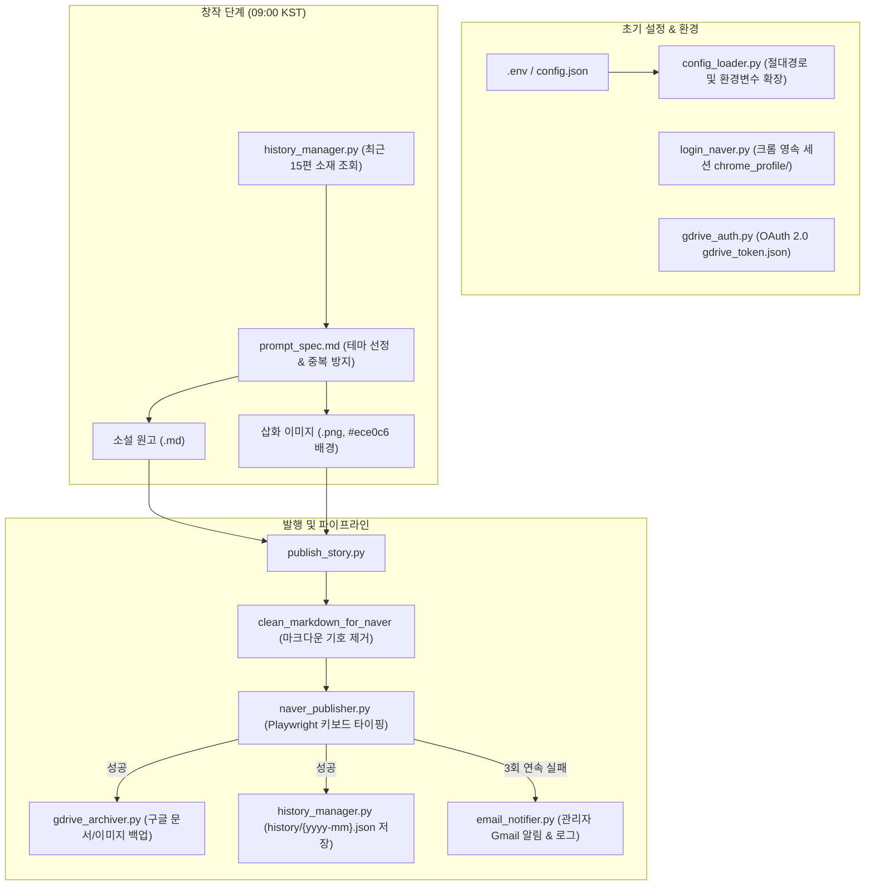

# Naver Blog Daily Fantasy Novel Automation (Quatsch)

네이버 블로그([sun_o_glitter](https://blog.naver.com/sun_o_glitter))의 `Quatsch` 카테고리에 매일 오전 09:00 (KST), 2000자 내외의 고품격 환상문학 단편 소설과 고전 펜화 에칭 스타일 삽화를 자동으로 집필하고 게시하는 자동화 시스템입니다.

---

## 📁 주요 구성 파일

* `prompt_spec.md`: 고전 중세 다크판타지/신비주의 문학 창작 명세서 (테마 A~J 순환 및 금지어/서식 규칙)
* `history_manager.py`: 월별 히스토리(`history/{yyyy-mm}.json`) 관리 및 최근 소재 중복 방지 로더
* `history/{yyyy-mm}.json`: 월별 발행 및 마이그레이션된 소설의 날짜, 제목, 테마, 핵심 컨셉, 태그 아카이브
* `config_loader.py`: `.env` 파일과 `config.json`을 연동하여 환경변수 및 상대경로를 자동 확장하는 중앙 설정 로더
* `config.json`: 블로그 기본 설정 템플릿 (`.env` 환경변수로 값 바인딩)
* `.env.example`: 로컬 환경 설정 템플릿 (블로그 ID, 이메일 알림 수신자, 크롬 프로필 경로 등)
* `login_naver.py`: 전용 크롬 프로필(`chrome_profile/`)을 띄워 네이버에 1회 사전 로그인하는 도구
* `editor_style.py`: 스마트에디터 ONE 서식 스타일(폰트, 크기, 색상, 정렬, 줄간격) 일괄 제어 모듈
* `naver_publisher.py`: Playwright 기반 스마트에디터 ONE 자동 글쓰기 (설정된 post_style 자동 적용, 마크다운 문법 자동 제거, 삽화 중간 삽입, 태그 등록 및 즉시 발행)
* `publish_story.py`: 3회 재시도 루프와 최종 실패 시 이메일 알림(Fallback)이 내장된 블로그 발행기
* `email_notifier.py`: 3회 연속 실패 시 `[gemini-automation-failed] {스케쥴 제목}` 메일 발송 및 로그 기록기
* `migrate_tags.py`: 블로그 내 기존 이전 글들을 검색하여 신규 태그 및 서식 스타일을 일괄 마이그레이션하는 고도화 도구
* `gdrive_archiver.py`: Google Drive의 `__generated__/gemini-hobby-fantasy-scene` 경로에 문서를 자동 생성/동기화하는 아카이버
* `gdrive_auth.py`: Google Drive API 1회 인증 도구

---

## 🎨 문서 스타일 및 서식 커스터마이징 (post_style)

소설 본문의 가독성과 블로그 컨셉 통일성을 위해 `config.json` 또는 환경변수를 통해 모든 포스팅의 서식을 통합 제어합니다.

| 서식 대상 | 설정 가능 옵션 | 기본값 | 비고 |
| :--- | :--- | :--- | :--- |
| **폰트 (Font)** | `기본서체`, `나눔명조`, `마루부리`, `나눔고딕`, `나눔바른고딕`, `나눔스퀘어`, `다시시작해`, `바른히피`, `우리딸손글씨` | `기본서체` | 환상문학 단편에는 `나눔명조`나 `마루부리`도 탁월한 가독성을 제공합니다. |
| **글씨 크기 (Size)** | `11`, `13`, `15`, `16`, `19`, `24`, `28`, `30`, `34`, `38` pt | `15` | 네이버 블로그 스마트에디터 표준 크기 지원 |
| **글씨 색상 (Color)** | `색상없음`(기본 투명/기본 검정) 또는 팔레트/커스텀 HEX (`#000000`, `#333333` 등) | `색상없음` | HEX 코드 직접 입력 및 72색 팔레트 완벽 연동 |
| **텍스트 정렬 (Align)** | `left`(왼쪽), `center`(가운데), `right`(오른쪽), `justify`(양쪽) | `left` | 본문 전체 일괄 정렬 적용 |
| **줄간격 (Line Height)** | `150%`, `160%`, `170%`, `180%`, `190%`, `200%`, `210%` | `180%` | 긴 호흡의 소설 줄글에 최적화된 행간 제어 |

> **태그 규칙 (정확히 5~6종)**:
> * **기본 태그 (3종 고정)**: `#판타지소설`, `#단편소설`, `#환상문학`
> * **특정 태그 (2~3종 맞춤)**: 소설의 고유 테마, 제목, 핵심 소재에서 유입에 유리한 키워드 추출

---

## 🚨 실패에 대한 Fallback (재시도 및 이메일 알림)

* 발행 중 일시적 네트워크 오류나 에디터 지연 발생 시 **최대 3회 자동 재시도** (10초, 20초 간격 점진적 대기)
* 3회 모두 실패할 경우:
  * 수신자: `.env`의 `EMAIL_RECIPIENT`로 설정된 이메일 주소
  * 메일 제목: `[gemini-automation-failed] Daily Naver Blog Fantasy Novel`
  * 본문: 실패 사유, 발생 일시, 상세 트레이스백
  * `.env`의 `GMAIL_APP_PASSWORD`에 구글 앱 비밀번호(16자리)를 입력하시면 즉시 이메일 발송 연동이 완료됩니다. (미설정 시에도 `./generated/failure_alerts.log`에 에러 내역이 안전하게 보존됩니다.)

---

## ⏰ 일일 자동화 동작 방식 (매일 09:00 KST)

1. **히스토리 확인 & 테마 선정**: `history/{yyyy-mm}.json`의 최근 발행 내역을 읽어 최근 다룬 테마/소재를 제외하고 신규 테마(A~J)를 선정.
2. **소설 창작**: `prompt_spec.md` 명세에 맞춰 2,000자 내외의 옴니버스 단편 소설과 에칭풍 삽화 영문 프롬프트 생성.
3. **삽화 생성**: 영문 프롬프트로 고해상도 펜화 에칭 일러스트(#ece0c6 배경색 엄수)를 생성하여 `./generated/{yyyy-mm}/{dd}-{title}.png`로 저장.
4. **소설 저장**: `./generated/{yyyy-mm}/{dd}-{title}.md`에 원고 저장.
5. **블로그 즉시 발행**: `publish_story.py` 실행 (마크다운 정제 -> 기본서체/15pt 입력 -> 서사 흐름에 맞는 위치에 삽화 삽입 -> 태그 5종 입력 -> 즉시 발행).
6. **히스토리 업데이트**: 발행된 글의 메타데이터를 `history/{yyyy-mm}.json`에 실시간 기록.

---

## 🛠️ 수동 실행 명령어 가이드 (Manual Commands)

### 1. 초기 환경 설정 및 1회성 계정 연동

* **네이버 블로그 로그인 세션 등록**
  ```bash
  python login_naver.py
  ```
  전용 크롬 프로필(`chrome_profile/`) 창이 열리면 네이버 계정에 로그인(‘로그인 상태 유지’ 권장)한 후 콘솔에서 `Enter`를 누릅니다. 이후 자동화 스크립트가 해당 로그인 세션을 영구 재사용합니다.

* **Google Drive API 인증**
  ```bash
  python gdrive_auth.py
  ```
  OAuth 인증 브라우저 창이 열리면 대상 구글 계정으로 로그인 및 권한을 승인합니다. 완료 시 `gdrive_token.json`이 자동 저장됩니다.

---

### 2. 단편 소설 및 삽화 수동 발행 (`publish_story.py`)

지정된 소설 마크다운 원고와 삽화 이미지를 정제하여 네이버 블로그에 포스팅하고 Google Drive에 동시 아카이빙합니다.

* **기본 실행 (브라우저 확인 가능)**
  ```bash
  python publish_story.py --story ./generated/2026-10/19-침묵의\ 방직공과\ 별빛의\ 매듭.md --image ./generated/2026-10/19-침묵의\ 방직공과\ 별빛의\ 매듭.png
  ```

* **헤드리스 모드 실행 (백그라운드)**
  ```bash
  python publish_story.py --story <소설.md> --image <삽화.png> --headless
  ```

> **포함 동작**:
> 1. 마크다운 문법 기호(`>`, `**`, `---` 등) 자동 정제
> 2. 스마트에디터 ONE 서식(기본서체, 15pt, 기본색상) 적용
> 3. 본문 내 `[삽화 삽입 위치]`에 이미지 자동 업로드
> 4. 기본 태그 3종 + 제목/내용 기반 특정 태그 2~3종 자동 등록
> 5. 즉시 발행 및 Google Drive(`__generated__/gemini-hobby-fantasy-scene`) 문서/삽화 동기화
> 6. 실패 시 최대 3회 재시도 루프 및 최종 실패 시 이메일 알림 발송

---

### 3. 이전 포스팅 서식 스타일 및 태그 일괄 마이그레이션 (`migrate_tags.py`)

기존에 발행된 블로그 글들의 서식(폰트, 크기, 색상, 정렬, 줄간격)과 태그를 일괄 고속 업데이트합니다.

* **마이그레이션 미리보기 (브라우저 없이 대상 글/스타일/태그 고속 확인)**
  ```bash
  python migrate_tags.py --dry-run
  ```

* **전체 포스팅 서식 스타일 & 태그 동시 일괄 적용**
  ```bash
  python migrate_tags.py
  ```

* **서식 스타일만 일괄 변경 (태그는 기존 그대로 유지)**
  ```bash
  python migrate_tags.py --style-only --font-family 나눔명조 --font-size 16 --font-color "#333333" --align left --line-height 190
  ```

* **태그만 일괄 변경 (본문 서식 스타일은 기존 그대로 유지)**
  ```bash
  python migrate_tags.py --tags-only
  ```

* **모든 글에 강제 재적용 (`--force`) 및 지정 개수 테스트 (`--limit`)**
  ```bash
  python migrate_tags.py --force --limit 5
  ```

* **백그라운드(헤드리스) 모드로 실행**
  ```bash
  python migrate_tags.py --headless
  ```

> **지원 옵션 요약**:
> - `--style-only`: 스타일만 수정하고 태그는 유지
> - `--tags-only`: 태그만 수정하고 본문 스타일은 유지
> - `--font-family <서체>`: 폰트 즉시 오버라이드 (예: `나눔명조`, `마루부리`, `기본서체`)
> - `--font-size <pt>`: 크기 오버라이드 (예: `15`, `16`)
> - `--font-color <color>`: 색상 오버라이드 (예: `색상없음`, `"#333333"`)
> - `--align <mode>`: 정렬 오버라이드 (`left`, `center`, `right`, `justify`)
> - `--line-height <pct>`: 줄간격 오버라이드 (`180`, `190`, `200`)
> - `--force`: 히스토리 기록 여부와 무관하게 모든 글에 재적용
> - 수정 완료 즉시 `history/{yyyy-mm}.json`에 최신 서식과 태그 메타데이터가 실시간 영속화됩니다.

---

### 4. 개별 모듈 및 Fallback 테스트

* **Google Drive 아카이빙 단독 테스트**
  ```bash
  python gdrive_archiver.py
  ```

* **실패 알림 이메일(SMTP) 발송 및 로그 저장 테스트**
  ```bash
  python email_notifier.py
  ```

* **중앙 환경변수 및 상대경로 로더 검증**
  ```bash
  python -c "from config_loader import get_config; import json; print(json.dumps(get_config(), indent=2, ensure_ascii=False))"
  ```

---

## 🏗️ 시스템 아키텍처 및 주니어 개발자 가이드

프로젝트 유지보수 및 확장을 담당하는 주니어 개발자를 위한 핵심 기술 원리와 설계 결정 배경입니다.

### 1. 전체 데이터 흐름도 (Data Pipeline)



### 2. 핵심 설계 결정 및 기술적 FAQ

* **Q. 왜 `os.getcwd()` 대신 `Path(__file__).resolve().parent`를 기준으로 경로를 잡나요?**
  * Windows 작업 스케줄러나 백그라운드 서비스에서 스크립트를 호출할 때, 호출자의 작업 디렉터리가 `C:\Windows\System32` 등으로 달라질 수 있습니다. `config_loader.py`의 위치를 기준으로 프로젝트 루트(`PROJECT_ROOT`)를 고정하여 경로 불일치 버그를 근본적으로 방지합니다.

* **Q. 네이버 에디터에 왜 `innerHTML`이나 자바스크립트 주입 대신 `keyboard.insert_text()`를 쓰나요?**
  * 스마트에디터 ONE은 React 기반의 contenteditable 에디터입니다. DOM 트리를 직접 수정하면 React 내부 Virtual DOM State와 동기화되지 않아 발행 시 내용이 증발합니다. 실제 사용자 키 입력 이벤트를 발생시켜야 State가 올바르게 업데이트됩니다.

* **Q. 왜 브라우저 대신 HTTP 요청(urllib)으로 글 목록을 탐색하나요?**
  * 네이버 블로그의 iframe 페이지네이션을 브라우저로 클릭하면 2페이지 이후 로딩 지연 및 레이스 컨디션이 빈번합니다. 반면 `PostList.naver`에 HTTP GET 요청을 보내면 서버가 `socialPluginInfoJson` 안에 전체 글 번호와 제목을 정형 JSON으로 내려주므로, 70편 전체를 2초 만에 오차 없이 수집할 수 있습니다.

* **Q. 히스토리 파일을 왜 월별(`history/{yyyy-mm}.json`)로 분할했나요?**
  * 단일 `history.json` 파일은 수백 편이 쌓일수록 I/O 비용이 급증하고 정전이나 비정상 종료 시 전체 데이터 손상 위험이 있습니다. 월별 분할을 적용하면 활성 파일 크기가 작게 유지되며, 최근 소재 중복 검사 시에도 최신 1~2개 월 파일만 읽으면 되므로 매우 효율적입니다.

* **Q. 제목에서 태그를 추출할 때 정규식이 복잡한 이유는 무엇인가요?**
  * "기억을 거래하는 숲의 길잡이와 살구 타르트"에서 단순 공백 분리를 하면 `['#기억을', '#거래하는']`처럼 무의미한 조사와 관형형 동사가 추출됩니다. `와/과` 대등 구문 분리, 관형어/동사 제거 정규식(`VERB_STRIP_REGEX`), 그리고 조사 제거 시 단어 손상을 막는 긍정형 후방탐색(`(?<=[가-힣])`)을 적용해 `#길잡이`, `#살구타르트` 같은 핵심 명사만 정밀하게 추출합니다.
